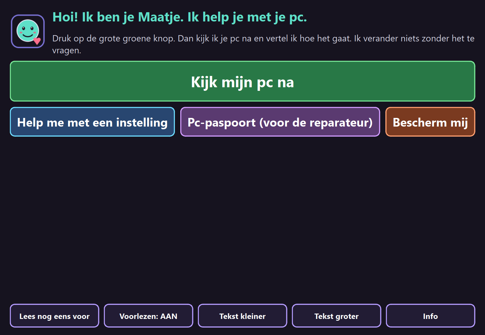
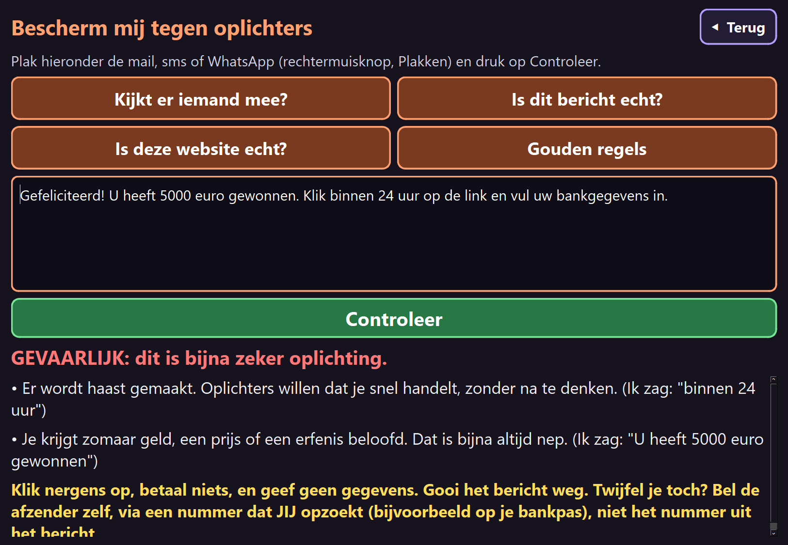

# DraveMaatje

**Je maatje voor de pc.** Voor ouderen, en voor iedereen die geen zin heeft in pc-gedoe. Groot en duidelijk, in gewone taal, en het Maatje leest alles hardop voor.

## 🎬 Uitlegvideo

[▶ Bekijk de uitlegvideo](https://dravenlock.nl/video/DraveMaatje.mp4) (1 minuut 45, Nederlands). Hij zit ook in de download.

## Wat kan het Maatje?

- **Kijk mijn pc na** – één grote knop. Het Maatje vertelt hoe het met je pc gaat: schijven, geheugen, virusscanner, firewall, updates, programma's die meestarten en rommel. Groen = goed, geel = let op, rood = aandacht.
- **Ruim de rommel op** – alleen als jij op **JA** drukt, en alles gaat naar de **prullenbak**. Je kunt het dus altijd terughalen.
- **Help me met een instelling** – Microsoft verstopt veel instellingen diep. Typ in gewone woorden wat je wilt (*muis groter*, *ik hoor niets*, *wifi doet het niet*). Het Maatje doet het voor je (na JA, met **Terugzetten**), of opent de goede pagina en vertelt stap voor stap wat je moet doen. 20 klusjes.
- **Pc-paspoort** – gaat je pc naar de reparateur? Maak eerst een paspoort met de serienummers van de onderdelen. Krijg je hem terug, dan zie je zwart op wit of het je **eigen** pc is.
- **Bescherm mij** – tegen oplichters:
  - *Kijkt er iemand mee?* (AnyDesk, TeamViewer en andere meekijk-programma's)
  - *Is dit bericht echt?* Plak een mail, sms of WhatsApp. Het Maatje laat bij elke reden zien wat het zag.
  - *Is deze website echt?* Herkent nep-namen zoals `rabobank-veilig-inloggen.nl`.
  - *Gouden regels* tegen oplichters, voorgelezen.

## 🔒 Veilig

- Het Maatje verandert **nooit** iets zonder het eerst te vragen. Jij drukt zelf op JA.
- Je beveiliging (virusscanner, firewall) verandert het Maatje nooit zelf.
- Het komt niet aan je foto's, documenten of wachtwoorden.
- **Alles blijft op je eigen pc.** Er gaat niets naar internet. Wat het Maatje doet, staat in `handen_logboek.txt`.

*Versie 0.6*

## ⬇️ Downloaden (Windows, geen Python nodig)

### [👉 Download DraveMaatje 0.6](https://github.com/mbrv4ever/DraveMaatje/releases/latest)

1. Klik op de link en download het **.zip**-bestand.
2. Pak het uit: rechtsklik → **Alles uitpakken...**
3. Dubbelklik op **DraveMaatje.exe**.
4. Lees eerst **Lees_mij_eerst.pdf** (grote letters). Er zit ook een snelgids met plaatjes bij.

> Zie je een blauw scherm "Windows heeft uw pc beschermd"? Klik op **Meer informatie** → **Toch uitvoeren**.

## Vanaf de broncode

Installeer Python 3.10 – 3.12 en de pakketten uit `requirements.txt`, en start `main.py`. `Start-DraveMaatje.bat` doet dit voor je; `Build-DraveMaatje-EXE.bat` maakt de .exe.

DraveMaatje gebruikt dezelfde "handen" als Drave Visual Buddy: `handen.py` (pc nakijken, opruimen), `klusjes.py` (instellingen), `paspoort.py`, `bescherm.py` en `handen_qt.py` (de gedeelde schermen).

## Licentie

Vrije software onder de **GNU GPL v3.0** (zie [LICENSE](LICENSE)). Gemaakt door **Dravenlock** (Roger & Claudio). Gratis; donaties welkom, nooit verplicht: [paypal.me/roger076](https://paypal.me/roger076). Vragen: service@dravenlock.nl
